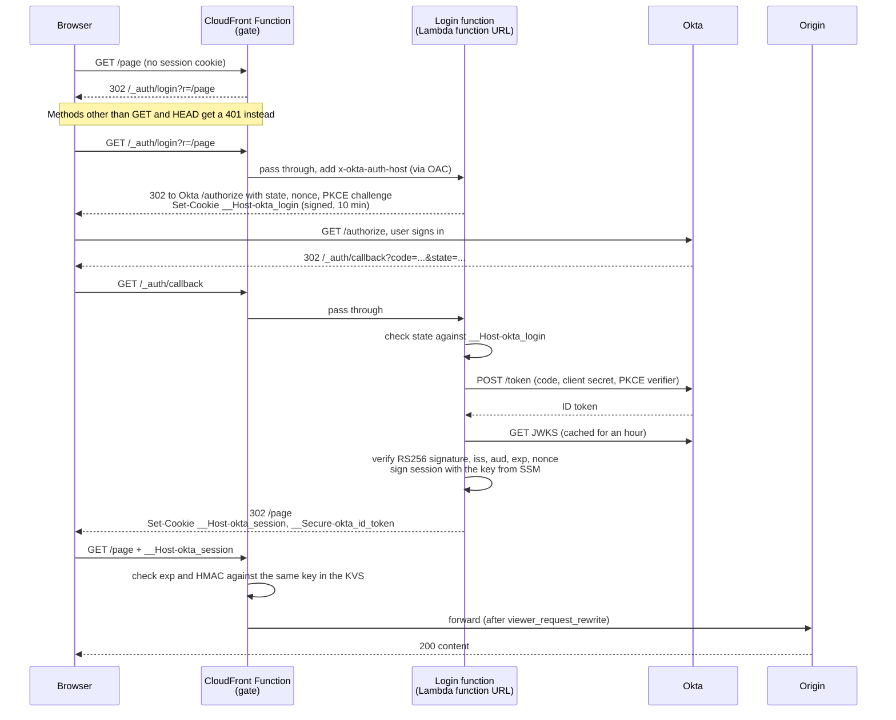

# Terraform AWS CloudFront Okta Auth

Puts Okta login in front of an existing CloudFront distribution without Lambda@Edge.

- **The gate** is a CloudFront Function (`cloudfront-js-2.0`) on viewer-request. It checks an HMAC-signed session cookie against a key in a CloudFront KeyValueStore. It makes no network calls and has no cold start, so cached objects stay behind the gate at CloudFront Functions latency.
- **The login** is a regional Lambda function behind a Lambda function URL. It runs the OpenID Connect authorization-code flow (with PKCE) against Okta, verifies the ID token's RS256 signature against Okta's JWKS, and issues the session cookie. It is only reached on `/_auth/*`, so a cold start costs one login, not every request.

The module creates:

- the CloudFront Function
- the key value store
- the login function, its IAM role and its function URL
- two SSM SecureString parameters, one for the Okta client secret and one for the generated session signing key

The client secret and the session key are written through write-only arguments, so neither lands in the Terraform plan or state. The distribution, its cache behaviors, the origin access control and the Lambda permissions stay with the caller, because they reference the distribution.

## Usage

```hcl
module "okta_auth" {
  source = "git::https://github.com/DND-IT/terraform-aws-cloudfront-okta-auth.git?ref=v0.2.0"

  okta_client_id             = var.okta_client_id
  okta_client_secret         = var.okta_client_secret # ephemeral, never stored in state
  okta_client_secret_version = 1                      # bump after rotating the secret in Okta
  okta_issuer                = "https://acme.okta.com" # or https://acme.okta.com/oauth2/default
}

resource "aws_cloudfront_origin_access_control" "login" {
  name                              = "okta-login"
  origin_access_control_origin_type = "lambda"
  signing_behavior                  = "always"
  signing_protocol                  = "sigv4"
}

resource "aws_lambda_permission" "login_url" {
  action        = "lambda:InvokeFunctionUrl"
  function_name = module.okta_auth.lambda_function_name
  principal     = "cloudfront.amazonaws.com"
  source_arn    = aws_cloudfront_distribution.site.arn
}

resource "aws_lambda_permission" "login" {
  action        = "lambda:InvokeFunction"
  function_name = module.okta_auth.lambda_function_name
  principal     = "cloudfront.amazonaws.com"
  source_arn    = aws_cloudfront_distribution.site.arn
}

resource "aws_cloudfront_distribution" "site" {
  # ...

  origin {
    origin_id                = "login"
    domain_name              = module.okta_auth.function_url_domain
    origin_access_control_id = aws_cloudfront_origin_access_control.login.id

    custom_origin_config {
      http_port              = 80
      https_port             = 443
      origin_protocol_policy = "https-only"
      origin_ssl_protocols   = ["TLSv1.2"]
    }
  }

  ordered_cache_behavior {
    path_pattern             = module.okta_auth.auth_path_pattern # /_auth/*
    target_origin_id         = "login"
    viewer_protocol_policy   = "https-only"
    allowed_methods          = ["GET", "HEAD", "OPTIONS"]
    cached_methods           = ["GET", "HEAD"]
    cache_policy_id          = data.aws_cloudfront_cache_policy.caching_disabled.id           # Managed-CachingDisabled
    origin_request_policy_id = data.aws_cloudfront_origin_request_policy.all_viewer_except_host.id # Managed-AllViewerExceptHostHeader

    function_association {
      event_type   = "viewer-request"
      function_arn = module.okta_auth.cloudfront_function_arn
    }
  }

  default_cache_behavior {
    # ...
    viewer_protocol_policy = "redirect-to-https"

    function_association {
      event_type   = "viewer-request"
      function_arn = module.okta_auth.cloudfront_function_arn
    }
  }
}
```

[examples/complete](examples/complete) has the full wiring. Then register the redirect URIs on the Okta application (see below) and deploy.

Terraform writes the session key into the key value store with the AWS CLI (`scripts/put-session-key.sh`, run by a `local-exec` provisioner), because the provider has no write-only argument for key value store keys. The machine that runs `terraform apply` needs AWS CLI v2 with the same credentials as the provider.

## Okta application setup

Create an OIDC application of type **Web Application** with the **Authorization Code** grant, client authentication **Client secret**, and PKCE allowed. For every domain the distribution serves (custom aliases and, if used, the `*.cloudfront.net` name) register:

| Okta setting | Value |
| --- | --- |
| Sign-in redirect URIs | `https://<domain>/_auth/callback` |
| Sign-out redirect URIs | `https://<domain>/` |

Assign the users or groups that may access the site to the application. Okta rejects anyone who isn't assigned, and the login function then answers 403.

`okta_issuer` is the issuer of the authorization server that signs the ID tokens:

- Org authorization server: `https://acme.okta.com` (endpoints under `https://acme.okta.com/oauth2/v1/`)
- Custom authorization server: `https://acme.okta.com/oauth2/default` (endpoints under the issuer)

## Handling the secrets

`okta_client_secret` is declared `ephemeral`, and the module writes it to SSM with the provider's write-only `value_wo` argument. Terraform discards the value after the operation: it is not in the plan file, not in the state, and not visible in `terraform show`.

- The value you pass in must itself be ephemeral or come from outside the configuration. Declare your own variable with `ephemeral = true` and supply it at runtime (`TF_VAR_okta_client_secret` in CI, or `-var` locally), or read it from an ephemeral resource such as `ephemeral "aws_secretsmanager_secret_version"`. Do not put it in a committed `.tfvars` file.
- Terraform cannot detect drift in a write-only value. To rotate the secret, change it in Okta and increment `okta_client_secret_version`. The SSM parameter is rewritten only when that number changes, and running Lambda containers pick the new value up on their next cold start.

The session signing key comes from an ephemeral `random_password`. It is written to the second SSM parameter and to the key value store, and both happen only when `session_key_version` changes. Incrementing it rotates the key: the login function's environment changes so every container restarts with the new key, and everybody signs in once more.

## How it works



1. The CloudFront Function checks every request.
   - A valid `__Host-okta_session` cookie passes the request on, after the optional `viewer_request_rewrite`.
   - Without one, a GET or HEAD is redirected to `/_auth/login?r=<path>`, and anything else gets a 401.
2. `/_auth/login` redirects to Okta's authorize endpoint. State, nonce and the PKCE verifier are kept in a short-lived HMAC-signed cookie (`__Host-okta_login`, 10 minutes) together with the return path.
3. Okta redirects back to `/_auth/callback`. The login function:
   1. checks the state
   2. exchanges the code (client secret plus PKCE verifier) at the token endpoint
   3. verifies the ID token signature against Okta's JWKS
   4. checks `iss`, `aud`, `exp` and `nonce`
4. It then sets `__Host-okta_session` (`HttpOnly; Secure; SameSite=Lax; Path=/`) for `session_ttl_seconds`, 8 hours by default, and redirects to the original path.
   - The cookie value is `v1.<exp>.<base64url JSON {sub, email}>.<base64url HMAC-SHA256>`. A backend that holds the key can read the signed-in user from it.
   - The ID token is kept in `__Secure-okta_id_token`, scoped to `/_auth/`, as the logout hint.
5. `/_auth/logout` clears both cookies and signs the user out of Okta, returning to `https://<domain>/`.

## Wiring notes

- Associate the CloudFront Function with the default cache behavior, **every ordered cache behavior** that should be protected, and the `/_auth/*` behavior. Behaviors without it are unprotected. On `/_auth/*` the function lets the request through and forwards the viewer's host in `x-okta-auth-host`, which the login function needs for the OIDC redirect URI.
- `viewer_protocol_policy` must be `redirect-to-https` or `https-only`; the cookies are `Secure`.
- Do not include the `Cookie` header in the cache key of protected behaviors. The managed `CachingOptimized` policy is a good default.
- A viewer-request CloudFront Function cannot be combined with a viewer-request Lambda@Edge function on the same behavior. Use `viewer_request_rewrite` for URL rewriting, for example `index.html` for directory paths on an S3 origin; the module embeds it in the gate.
- The function URL uses `AWS_IAM` auth. CloudFront reaches it through an origin access control of type `lambda`, plus the two Lambda permissions shown above.
- There is no revocation: a session lasts until its cookie expires or the key is rotated.

### Upgrading from 0.1.x

0.1.x ran everything in a Lambda@Edge viewer-request function in us-east-1. Its first invocation on a new container often came close to the 5 s viewer-request limit, and CloudFront answered 503 when it ran over. To upgrade:

1. Drop the us-east-1 provider alias from the module call, so the login function is created in your default region.
2. Swap the `lambda_function_association` for a `function_association`.
3. Add the `/_auth/*` behavior, the origin access control and the permissions.
4. Apply.

The module's `removed` blocks make Terraform forget the old resources instead of destroying them, because a Lambda@Edge function can't be deleted while CloudFront still holds replicas of it, and in-flight requests still use it while the distribution change propagates. The forgotten resources are:

- the Lambda@Edge function
- its IAM role and role policy
- the us-east-1 SSM parameter

Delete them by hand once the distribution has finished deploying and the replicas are gone. Existing sessions are signed out once.

## Examples

- [complete](examples/complete): private S3 bucket, S3 origin access control, CloudFront distribution and this module, with outputs listing the URIs to register in Okta.

## Contributing

Issues and pull requests are welcome. The function code has no npm dependencies; run the unit tests and Terraform tests before opening a PR:

```shell
node --test "lambda/test/*.test.mjs"
terraform init -backend=false && terraform test
```

### Pre-Commit

Installation: [install pre-commit](https://pre-commit.com/) and execute `pre-commit install`. This will generate pre-commit hooks according to the config in `.pre-commit-config.yaml`

Before submitting a PR be sure to have used the pre-commit hooks or run: `pre-commit run -a`

The `pre-commit` command will run:

- Terraform fmt
- Terraform validate
- Terraform docs
- Terraform validate with tflint
- check for merge conflicts
- fix end of files

as described in the `.pre-commit-config.yaml` file

## Versioning and Releases

This module follows [Semantic Versioning](https://semver.org/) (`MAJOR.MINOR.PATCH`). Releases are automated with [semantic-release](https://github.com/semantic-release/semantic-release) and derived from [Conventional Commits](https://www.conventionalcommits.org/) on `main`.

**The module is pre-1.0.** While the version is `0.x`, the public interface may change between MINOR versions: breaking commits (`feat!:`, `fix!:`, `BREAKING CHANGE:`) bump MINOR, not MAJOR (`releaseRules` in `.releaserc.json`). Pin to an exact `0.x.y` version. Once the interface is stable the rule is removed and `1.0.0` is cut; from then on:

| Commit type | Example | Version bump |
| ----------- | ------- | ------------ |
| `fix:` | `fix: reject tokens without kid` | PATCH (`x.y.Z`) |
| `feat:` | `feat: add logout path output` | MINOR (`x.Y.0`) |
| `feat!:` / `fix!:` or a `BREAKING CHANGE:` footer | `feat!: rename okta_issuer` | MAJOR (`X.0.0`) |

Guidelines for choosing the bump:

- **PATCH**: backwards-compatible bug fixes that do not change the module interface or default behaviour.
- **MINOR**: backwards-compatible new features (new variables, new optional resources) where existing configurations keep working unchanged.
- **MAJOR**: any backwards-incompatible change: removed or renamed variables/outputs, changed defaults that alter live infrastructure, or behaviour that requires consumers to take action before upgrading.

Always pin the module to a specific version so that MAJOR releases never reach your infrastructure unintentionally.

<!-- BEGIN_TF_DOCS -->
## Requirements

| Name | Version |
| ---- | ------- |
| <a name="requirement_terraform"></a> [terraform](#requirement\_terraform) | >= 1.11 |
| <a name="requirement_archive"></a> [archive](#requirement\_archive) | >= 2.7 |
| <a name="requirement_aws"></a> [aws](#requirement\_aws) | >= 6.0 |
| <a name="requirement_random"></a> [random](#requirement\_random) | >= 3.7 |

## Providers

| Name | Version |
| ---- | ------- |
| <a name="provider_archive"></a> [archive](#provider\_archive) | >= 2.7 |
| <a name="provider_aws"></a> [aws](#provider\_aws) | >= 6.0 |
| <a name="provider_terraform"></a> [terraform](#provider\_terraform) | n/a |

## Modules

No modules.

## Resources

| Name | Type |
| ---- | ---- |
| [aws_cloudfront_function.gate](https://registry.terraform.io/providers/hashicorp/aws/latest/docs/resources/cloudfront_function) | resource |
| [aws_cloudfront_key_value_store.this](https://registry.terraform.io/providers/hashicorp/aws/latest/docs/resources/cloudfront_key_value_store) | resource |
| [aws_iam_role.login](https://registry.terraform.io/providers/hashicorp/aws/latest/docs/resources/iam_role) | resource |
| [aws_iam_role_policy.login](https://registry.terraform.io/providers/hashicorp/aws/latest/docs/resources/iam_role_policy) | resource |
| [aws_lambda_function.login](https://registry.terraform.io/providers/hashicorp/aws/latest/docs/resources/lambda_function) | resource |
| [aws_lambda_function_url.login](https://registry.terraform.io/providers/hashicorp/aws/latest/docs/resources/lambda_function_url) | resource |
| [aws_ssm_parameter.okta_client_secret](https://registry.terraform.io/providers/hashicorp/aws/latest/docs/resources/ssm_parameter) | resource |
| [aws_ssm_parameter.session_key](https://registry.terraform.io/providers/hashicorp/aws/latest/docs/resources/ssm_parameter) | resource |
| [terraform_data.session_key](https://registry.terraform.io/providers/hashicorp/terraform/latest/docs/resources/data) | resource |
| [archive_file.this](https://registry.terraform.io/providers/hashicorp/archive/latest/docs/data-sources/file) | data source |
| [aws_caller_identity.current](https://registry.terraform.io/providers/hashicorp/aws/latest/docs/data-sources/caller_identity) | data source |
| [aws_region.current](https://registry.terraform.io/providers/hashicorp/aws/latest/docs/data-sources/region) | data source |

## Inputs

| Name | Description | Type | Default | Required |
| ---- | ----------- | ---- | ------- | :------: |
| <a name="input_name"></a> [name](#input\_name) | Name of the CloudFront Function, key value store, login Lambda function, IAM role and SSM parameter prefix. | `string` | `"cloudfront-okta-auth"` | no |
| <a name="input_okta_client_id"></a> [okta\_client\_id](#input\_okta\_client\_id) | Client ID of the Okta OIDC web application. | `string` | n/a | yes |
| <a name="input_okta_client_secret"></a> [okta\_client\_secret](#input\_okta\_client\_secret) | Client secret of the Okta OIDC web application. Ephemeral: written to an SSM SecureString parameter and never stored in state or plan. Bump okta\_client\_secret\_version to rotate it. | `string` | n/a | yes |
| <a name="input_okta_client_secret_version"></a> [okta\_client\_secret\_version](#input\_okta\_client\_secret\_version) | Version marker for okta\_client\_secret. Terraform only rewrites the SSM parameter when this value changes, so increment it whenever the secret is rotated. | `number` | `1` | no |
| <a name="input_okta_issuer"></a> [okta\_issuer](#input\_okta\_issuer) | Okta issuer URL without trailing slash: the org authorization server (https://acme.okta.com) or a custom authorization server (https://acme.okta.com/oauth2/default). | `string` | n/a | yes |
| <a name="input_session_key_version"></a> [session\_key\_version](#input\_session\_key\_version) | Version marker for the generated session signing key. Increment it to rotate the key, which signs everybody out once. | `number` | `1` | no |
| <a name="input_session_ttl_seconds"></a> [session\_ttl\_seconds](#input\_session\_ttl\_seconds) | Lifetime of the session cookie issued after a successful login. | `number` | `28800` | no |
| <a name="input_tags"></a> [tags](#input\_tags) | Tags applied to all resources that support them. | `map(string)` | `{}` | no |
| <a name="input_viewer_request_rewrite"></a> [viewer\_request\_rewrite](#input\_viewer\_request\_rewrite) | JavaScript source defining `function rewrite(request)` for the CloudFront Function. It runs on every authenticated request and must return the request, for example after mapping directory paths to index.html. The default returns the request unchanged. | `string` | `"function rewrite(request) { return request; }"` | no |

## Outputs

| Name | Description |
| ---- | ----------- |
| <a name="output_auth_path_pattern"></a> [auth\_path\_pattern](#output\_auth\_path\_pattern) | Path pattern of the cache behavior that routes the login endpoints to the function URL origin. |
| <a name="output_callback_path"></a> [callback\_path](#output\_callback\_path) | Path that must be registered in Okta as sign-in redirect URI: https://<site-domain><callback\_path>. |
| <a name="output_cloudfront_function_arn"></a> [cloudfront\_function\_arn](#output\_cloudfront\_function\_arn) | ARN of the CloudFront Function. Associate it as viewer-request with the default cache behavior, every protected ordered cache behavior and the auth\_path\_pattern behavior. |
| <a name="output_function_url_domain"></a> [function\_url\_domain](#output\_function\_url\_domain) | Domain of the login Lambda function URL, for the CloudFront origin behind auth\_path\_pattern. The URL uses AWS\_IAM auth, so the origin needs an origin access control of type lambda. |
| <a name="output_key_value_store_arn"></a> [key\_value\_store\_arn](#output\_key\_value\_store\_arn) | ARN of the CloudFront key value store holding the session signing key. |
| <a name="output_lambda_function_arn"></a> [lambda\_function\_arn](#output\_lambda\_function\_arn) | ARN of the login Lambda function. |
| <a name="output_lambda_function_name"></a> [lambda\_function\_name](#output\_lambda\_function\_name) | Name of the login Lambda function. Grant cloudfront.amazonaws.com lambda:InvokeFunctionUrl and lambda:InvokeFunction on it, scoped to the distribution ARN. |
| <a name="output_lambda_role_arn"></a> [lambda\_role\_arn](#output\_lambda\_role\_arn) | ARN of the login Lambda function's execution role. |
| <a name="output_login_path"></a> [login\_path](#output\_login\_path) | Path that starts the Okta login; takes the return path as the r query parameter. |
| <a name="output_logout_path"></a> [logout\_path](#output\_logout\_path) | Path that clears the session and signs the user out of Okta. |
| <a name="output_okta_endpoints"></a> [okta\_endpoints](#output\_okta\_endpoints) | Okta endpoints derived from okta\_issuer. |
| <a name="output_session_cookie"></a> [session\_cookie](#output\_session\_cookie) | Name of the session cookie. Its value is v1.<exp>.<base64url JSON with sub and email>.<base64url HMAC-SHA256 of the first three parts>, signed with the key in the session\_key SSM parameter. |
| <a name="output_ssm_parameter_arns"></a> [ssm\_parameter\_arns](#output\_ssm\_parameter\_arns) | ARNs of the SSM SecureString parameters holding the Okta client secret and the session signing key. |
<!-- END_TF_DOCS -->

## Authors

Module is maintained by [Alfredo Gottardo](https://github.com/AlfGot), [David Beauvererd](https://github.com/Davidoutz), [Davide Cammarata](https://github.com/DCamma), [Francisco Ferreira](https://github.com/cferrera), [Roland Bapst](https://github.com/rbapst-tamedia) and [Samuel Wibrow](https://github.com/swibrow)

## License

Apache 2 Licensed. See [LICENSE](LICENSE) for full details.
